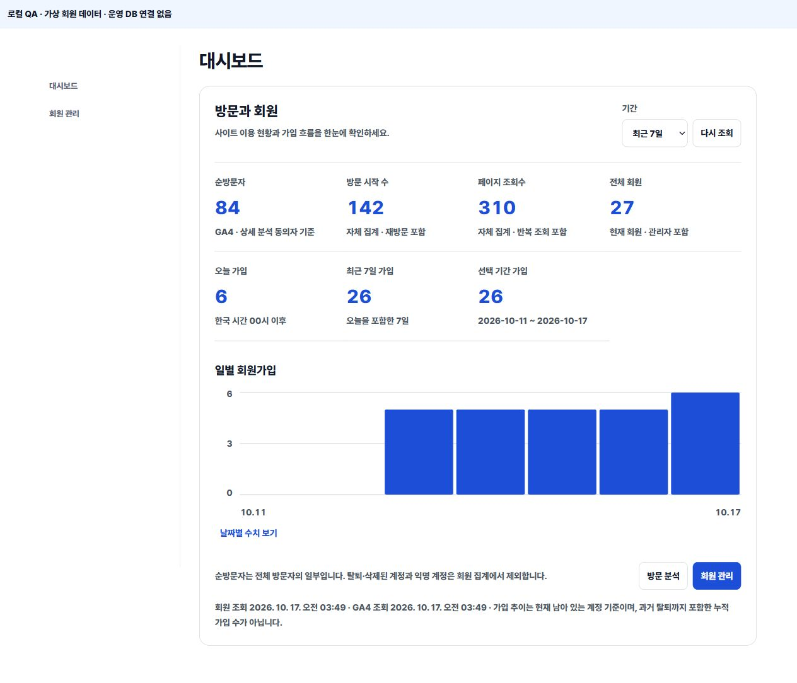
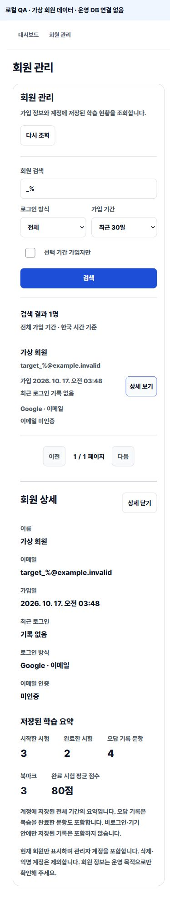
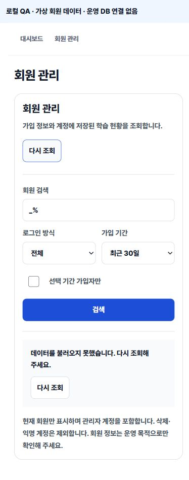

# 관리자 방문·회원 대시보드 구현 및 검증

작성: 2026-10-17 KST. 브랜치: `codex/admin-member-dashboard`. 기준 main: `94b661657089e52cbacca7e4251ad2be4c60550b`.

**로컬 구현·검증 완료. 운영 DB·Edge Function·웹은 미반영이다. 캡처의 모든 회원·방문 숫자와 이메일은 가상 데이터다. 실제 고객 정보를 조회하거나 캡처하지 않았다.**

## 변경 결과

| 항목 | 이전 | 구현 후 |
| --- | --- | --- |
| 관리자 첫 화면 | 상품 관리로 진입 | 대시보드로 진입, 기존 상품 관리 메뉴 유지 |
| 대시보드 | 상품·주문·다운로드 중심 | 상단에 방문·회원 현황, 하단에 기존 운영 지표 유지 |
| 순방문자 | 별도 GA4 메뉴에서 확인 | 대시보드에도 표시, ‘GA4 · 상세 분석 동의자 기준’ 명시 |
| 자체 집계 | 별도 방문 분석 | 방문 시작·조회수 요약도 표시, 순방문자와 분리 |
| 가입 수 | GA4의 제한된 가입 이벤트 | 실제 Auth 회원 생성 시각으로 오늘·최근 7일·선택 기간 집계 |
| 가입 추이 | 없음 | 최근 7일/30일 막대그래프·날짜별 수치 펼치기 |
| 회원 관리 | 없음 | 이름/이메일 검색, 로그인 방식·가입 기간 필터, 20명 페이지, 상세 |
| 회원 상세 | 없음 | 이름·이메일·가입/최근 로그인·방식·이메일 인증, 저장된 학습 요약 |
| 상태 | 회원 지표 없음 | 고정 높이 로딩, 오류·미연결·검색 없음·정상 0 구분, 재시도 |

회원 관리는 조회만 제공한다. 탈퇴/정지/권한 변경을 추가하지 않았다. 인증·결제·다운로드 계약과 회원가입 동작을 변경하지 않았다.

## 수치 정의

- 순방문자는 GA4가 보고한 선택 기간 `totalUsers`다. 분석을 허용한 방문자만 대상이며 전체 방문자 또는 정확한 자연인 수라고 주장하지 않는다. 기존 GA4 캐시/보고서 지연이 적용되며 조회 시각을 표시한다.
- 자체 기본 분석은 식별자 없는 방문 시작/페이지 조회다. 새 쿠키·IP 추적·기기 지문·회원과의 방문 연결을 추가하지 않는다. 두 출처를 더하지 않는다.
- 전체 회원은 현재 남은 Auth 영구 계정이다. 관리자·이메일 미인증 계정은 포함하고 삭제·익명 계정은 제외한다.
- 가입은 `auth.users.created_at` 기준이다. 오늘은 한국 시간 00:00~다음날 00:00, 최근 7일은 오늘을 포함한 7일이다. 과거 탈퇴 기록까지 포함한 누적 가입 수를 복원하지 않는다.
- 가입 추이는 선택 기간의 현재 회원을 날짜별로 센다. 정상적으로 0명인 날은 0으로 채우며 기간 합계와 일별 합계가 일치해야 한다.
- 로그인 방식은 연결된 providers 목록이다. 한 계정에 이메일·Google이 함께 있으면 두 방식 필터에 모두 포함한다. 회원 전체 수는 중복하지 않는다.
- 학습 요약은 서버에 저장된 전체 기간 기록이다. 시작/완료 시험, 완료 시험 평균 점수, 오답 기록 문항, 북마크다. 브라우저 안에만 있는 비회원 기록은 제외한다.
- 오답은 기존 UUID 문항과 NAS 문항의 `wrong_count > 0`을 센다. 복습 완료 문항은 포함하고 메모만 있는 문항은 제외한다. 개별 답안·메모는 조회 결과에 포함하지 않는다.

## 파일

| 파일 | 변경 |
| --- | --- |
| `components/admin-client.tsx` | 기본 메뉴, 회원 메뉴, 요약 연결, 새로고침 연결 |
| `components/admin-members.tsx` | 독립 방문·회원 로딩, 요약/그래프, 검색·페이지·상세·상태·포커스 |
| `app/admin-members.css` / `app/layout.tsx` | 관리자 전용 토큰 스타일과 CSS 로드 |
| `lib/admin-members.mjs` / `.d.mts` | 기간·요청 검증, 응답 필드 제한, 값·집계 일관성 검증 |
| `supabase/functions/admin-members/index.ts` | JWT·DB 관리자 검사, 타입 있는 RPC 호출 |
| `supabase/functions/_shared/admin-members-handler.mjs` | 요청 크기 제한, 입력 검증, 오류/권한 처리, private no-store |
| `supabase/migrations/20261016183059_admin_member_reporting.sql` | 서버 전용 읽기 집계·목록·상세 RPC |
| `scripts/test-admin-members.mjs` | 12개 기능/권한/응답/렌더링 회귀 검사 |
| `scripts/fixtures/admin-members-db.mjs` / `scripts/verify-admin-members-sql.mjs` | 임시 PostgreSQL에 실제 migration 실행·권한/데이터 검증 |
| `package.json` | `check:admin`에 새 테스트 연결, 앱 의존성 추가 없음 |
| `docs/ADMIN_CONSOLE.md` / `STATUS.md` / `DESIGN_SYSTEM.md` | 로컬 상태·정의·디자인 반영 |

기존 관련 없는 미추적 파일, 기존 법률 문서·보안 보고서·tmp 자료는 보존했다. 테스트용 PGlite 0.5.10과 esbuild 0.25.12는 `tmp/admin-members-sql/`에만 설치했다. 제품 package-lock/의존성은 바꾸지 않았다.

## 검증

| 검사 | 결과 |
| --- | --- |
| `npm run check` | exit 0. 새 회원 12개, 기존 분석 81개 및 기존 계약 검사 통과 |
| `npx tsc --noEmit` | exit 0 |
| `npx next build` | exit 0, 정적 페이지 30/30 생성 |
| `deno check --no-config supabase/functions/admin-members/index.ts` | exit 0 |
| `node scripts/verify-admin-members-sql.mjs` | 실제 로컬 PostgreSQL에서 migration 실행·검사 통과 |
| `git diff --check` | 통과 |
| Impeccable detector, 새 TSX/CSS | 지적 0건 |
| 독립 코드 리뷰 | 두 P2 수정 후 재검사, 남은 blocker 없음 |

SQL 검사는 가상 계정 27명과 익명/삭제 계정을 사용했다. 전체/기간 가입, KST 자정 1ms 전 경계, 연결된 로그인 방식, 20+7명 페이지 중복 없음, `%`·`_` 문자 그대로 검색, SQL 삽입 문자열, 없는 회원, 실제 anon/authenticated 실행 거부, service_role 실행과 지정 관리자 재확인을 검사했다. 기존+NAS 학습 요약(오답 4·북마크 3), NAS만 사용하는 회원(오답 1·북마크 1), 메모만 있는 문항 제외, 완료 시험만 평균에 포함함을 확인했다.

리뷰에서 찾은 NAS 상태 누락과 SQL/JS 이름 길이 차이는 실패하는 회귀 테스트를 먼저 재현한 뒤 수정했다. 이모지 200자는 허용하고 201자는 거부하도록 PostgreSQL 문자 단위와 맞췄다. 요청에는 4KiB 한도·100자 검색어·90일 최대 기간·허용 필드/방식·UUID 검증을 적용한다.

### 반응형 및 접근성

실제 React 컴포넌트 + 로컬 API handler + 임시 PostgreSQL을 연결한 Chromium 브라우저 검증이다. 인증 클라이언트와 방문 응답만 명시적인 fixture로 대체했다. 운영 로그인·Supabase 연결의 성공 증거가 아니다.

| 뷰포트 | 대시보드 scrollWidth | 회원 상세 scrollWidth | 새 조작 최소 높이 | 새 회원 조작 최소 폭 |
| --- | ---: | ---: | ---: | ---: |
| 360 | 345 | 345 | 44px | 44px |
| 390 | 375 | 375 | 44px | 44px |
| 430 | 415 | 415 | 44px | 44px |
| 1280 | 1265 | 1265 | 44px | 44px |

15px 차이는 브라우저 세로 스크롤바다. 모든 폭에서 페이지 가로 넘침 없음. 새 보조 텍스트/그래프 축 14px, 본문 16px. 실측 색 기준 대비: 본문 17.74:1, 보조 7.56:1, 파랑/흰색 6.70:1. 체크박스는 보이는 크기 20px, 입력 영역 44px. 상세 포커스 이동과 닫은 뒤 원래 버튼 복귀 확인.

검색·특수문자 검색·로그인 방식/가입 기간 필터·페이지 이동·상세 조회·수치 펼치기·검색 없음·실패→재시도를 확인했다. 오류에서는 0명을 표시하지 않으며 재시도로 정상 상태가 복구됐다. 실제 iPhone/Android, WebKit, 스크린리더 실기기 검증은 수행하지 않았다.

### 캡처

| 폭 | 대시보드 | 회원 검색·상세 |
| --- | --- | --- |
| 360 | [캡처](../reports/admin-members-20261017/overview-360.jpg) | [캡처](../reports/admin-members-20261017/members-detail-360.jpg) |
| 390 | [캡처](../reports/admin-members-20261017/overview-390.jpg) | [캡처](../reports/admin-members-20261017/members-detail-390.jpg) |
| 430 | [캡처](../reports/admin-members-20261017/overview-430.jpg) | [캡처](../reports/admin-members-20261017/members-detail-430.jpg) |
| 1280 | [캡처](../reports/admin-members-20261017/overview-1280.jpg) | [캡처](../reports/admin-members-20261017/members-detail-1280.jpg) |

가상 데이터 화면 예시:







원시 계측: [qa-metrics.json](../reports/admin-members-20261017/qa-metrics.json).

## 보안·운영 상태와 남은 검증

- 연결된 Supabase MCP가 권한 없음으로 운영 메타데이터 조회를 거절했다. 운영 회원 목록/개인정보/집계를 조회하지 않았다. 다른 계정으로 우회하거나 인증 설정을 변경하지 않았다.
- 새 함수는 요청 JWT와 DB 관리자 role을 검사하고, DB에서 기존 지정 관리자까지 재확인한다. 브라우저에 서비스 키·비밀번호·토큰·Auth metadata·개별 답안/메모를 반환하지 않는다. HTTP 응답은 `private, no-store`다.
- Auth 테이블 SELECT 권한을 브라우저 역할에 부여하지 않는다. RPC만 `service_role`에 허용한다. `SECURITY DEFINER`는 Auth가 공개 API에 노출되지 않도록 필요한 읽기 권한을 함수에 한정하기 위해 사용하며 빈 search_path·명시적 스키마·5초 statement_timeout을 적용한다.
- 기존 6개 법률/사업자 경고(일부 보관·국외 이전 명세, 미제공 환불/저작권 본문, 전화/운영시간)는 그대로 남았다. 이번 기능으로 해소된 것으로 처리하지 않았다.
- 배포 전 실제 DB 컬럼·지정 관리자 함수·학습 테이블과 migration 이력을 확인하고, 실제 관리자/비관리자 계정으로 권한과 집계를 대조해야 한다. 회원 수가 크게 늘면 5초 조회 예산 안의 실행계획도 확인한다.

## 적용 순서와 롤백

이번 승인은 구현 범위다. 아래 운영 반영은 아직 실행하지 않았으며 대상·영향을 검토한 별도 승인이 필요하다.

1. 권한이 있는 운영 연결에서 현행 schema·migration 이력을 읽기 전용으로 확인한다. 누락된 과거 migration을 일괄 적용하거나 운영 DB를 reset하지 않는다.
2. 새 migration 하나를 적용한다. 기존 회원 행/가입 트리거/인증·결제·다운로드 테이블은 변경하지 않으며 새 조회 함수만 추가한다.
3. `admin-members` Edge Function을 기존 JWT 검증 방식과 함께 배포한다. 비로그인 401/비관리자 403, 관리자 목록/집계, 응답 필드·캐시 헤더를 실제 요청으로 확인한다.
4. 웹을 배포하고 실제 `/admin/`의 수치·검색·필터·상세를 대조한다. GA4 동의자와 자체 집계는 계속 별도다.

롤백은 웹 변경 커밋을 revert하거나 이전 검증 배포로 복원하는 것이 우선이다. 새 읽기 함수/Edge가 남아 있어도 기존 회원·로그인·문제풀이에 영향을 주지 않는다. 필요하면 `admin-members` 배포만 제거하고 아래 정확한 함수 하나만 삭제한다. 테이블·회원 데이터·기존 admin/analytics 함수는 삭제하지 않는다.

```sql
drop function if exists public.admin_member_report(uuid,text,date,date,text,text,integer,boolean,uuid);
```

로컬 SQL 검사 재현용 도구 설치(앱 의존성 변경 없음):

```powershell
npm install --prefix tmp/admin-members-sql --no-save --no-audit --no-fund @electric-sql/pglite@0.5.10
node scripts/verify-admin-members-sql.mjs
```
